

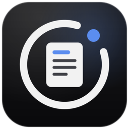

# Station Notes

A note-taking app for studying: an infinite canvas for mind maps, sticky notes, arrows and freehand drawing, plus plain text notes.
Windows, Linux and Android. No account, no ads, no telemetry. Distributed by OmniStation.

[Download](https://github.com/Fred-22-glitch/station-notes/releases/latest) · [Changelog](CHANGELOG.md) · [Guide](docs/GUIDE.md) · [Privacy](docs/PRIVACY.md)

---

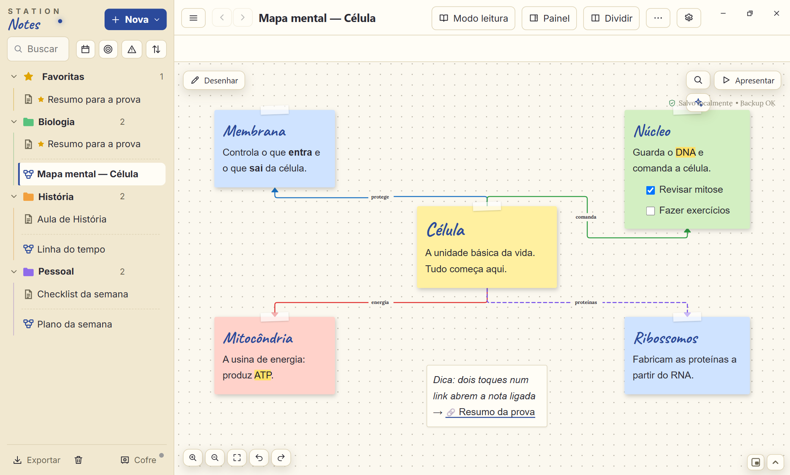

> Available in English, Spanish and Portuguese (⚙ → language).

## Features

**Canvas**
- Sticky notes, rectangles, ellipses, frames (moving a frame moves what's inside it) and ready-made tables
- One gesture per action, the same with mouse and touch: click to select, drag to move, double-click to edit the text, double-click the background to create a sticky note
- Arrows with heads, colors, dashes, labels and draggable curves
- Freehand drawing with smooth strokes (thicker where the pen presses), highlighter, shapes and an eraser that only erases where it passes. Drawings live on their own layer and stay sharp at any zoom
- Palm rejection: a hand resting on the screen doesn't draw or move anything; two fingers together pan and zoom
- Everything snaps to the dot grid (hold Alt to move freely), alignment guides, minimap and search inside the canvas
- Presentation mode (one frame at a time, fullscreen)
- Undo/redo, duplicate, copy and paste between notes

**Text notes**
- Laid out as a document page (A4 width, margins); full width on phones
- 24 fonts, exact font size (8–96), line spacing, colors, highlighter, headings, lists, checklists, tables, images, quotes and code blocks
- Built-in spell checker on every platform (Hunspell, on-device): misspelled words get a red wavy underline. On desktop, right-click for suggestions; on Android the keyboard already corrects, so a long press just offers Ignore or Add to dictionary
- Dictation with the app's own panel (live text and a Stop button)
- Continuous scroll or book mode (side-turning pages)
- Links between notes (`[[` or Ctrl+K) and full-text search; renaming the note's top heading renames the note
- Templates: lecture, summary, exam review, thesis chapter, exam study schedule, shopping list, to-do, checklist, meeting, journal, financial report, academic report and mind map

**Studying**
- Mistakes notebook: subject, topic, source, type of mistake, confidence, tags and date, plus questions with your answer, the right answer and an explanation. Search, filters and spaced review (1, 3, 7 and 14 days)
- Flashcards written by hand or created by the study AI, with spaced repetition
- Quick quiz built from a note by the study AI, with wrong answers sent to the mistakes notebook
- Calendar: reminders, and dates and tasks written in your notes; tap a day to add a reminder or create a journal, meeting, class or to-do note for it
- Read aloud: the whole note or the selected text, using the device's voice, with the current word highlighted
- Word goals, tags, favorites and read mode (hides the toolbars)
- In-note search, back/forward between notes, multi-select to move or trash notes

**Data**
- Notes are stored as `.json` files in a folder you pick (the "vault"), with folders and subfolders you can drag notes into. "Open folder" opens it in your file manager
- LAN sync between up to 4 of your devices with a 6-digit pairing code: no server, no account, encrypted. Settings list every device in the group, and any of them can be removed
- Daily automatic backups, per-note version history, 30-day trash
- Export to PDF, Word, Markdown, HTML, PNG (canvas) and Obsidian `.canvas`
- Notebook-style PDF (lined paper) and a story-sized or square image of a note for sharing

## Themes

Each theme restyles the whole app (paper, shapes, fonts and details), not just the colors.

<table>
<tr>
<td align="center">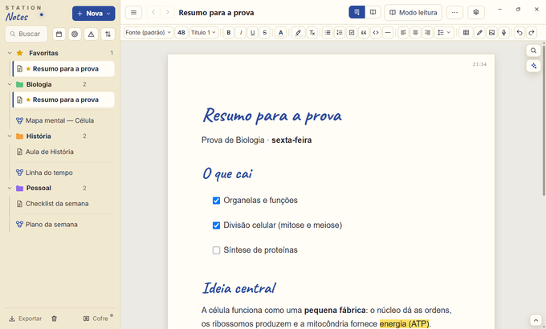 Notebook</td>
<td align="center">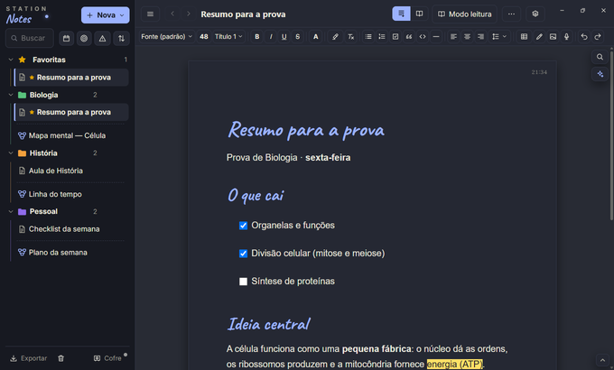 Notebook (dark)</td>
<td align="center">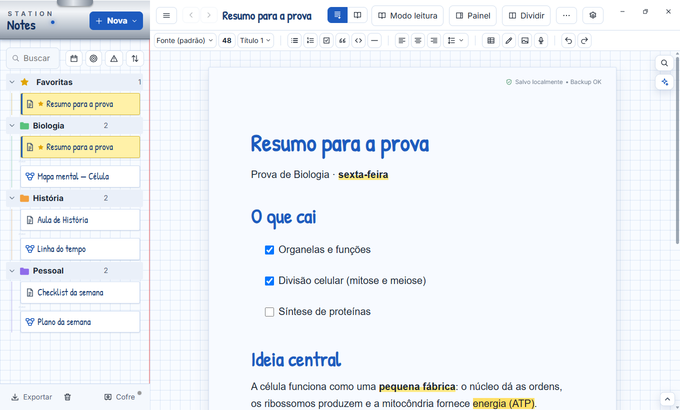 Graph paper</td>
</tr>
<tr>
<td align="center">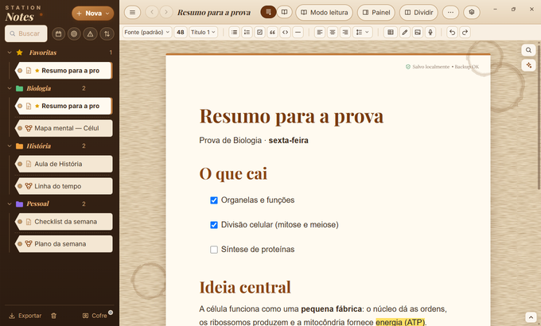 Coffee</td>
<td align="center">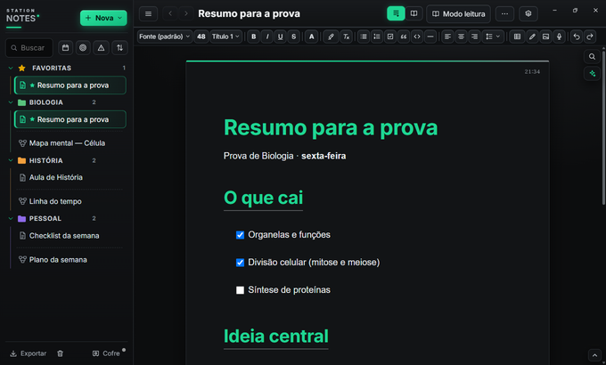 Titanium and emerald</td>
<td align="center">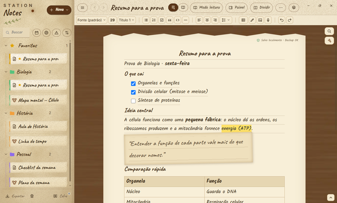 Heirloom notebook</td>
</tr>
<tr>
<td align="center">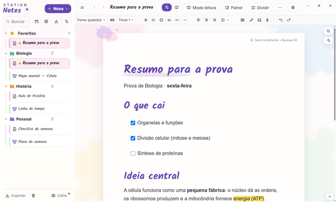 Watercolor</td>
<td align="center">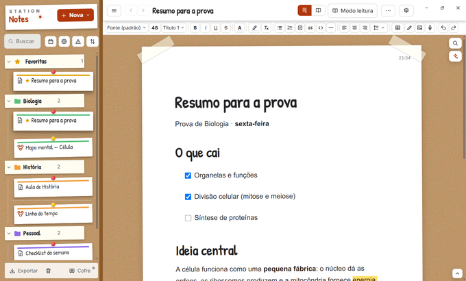 Polaroid</td>
<td align="center">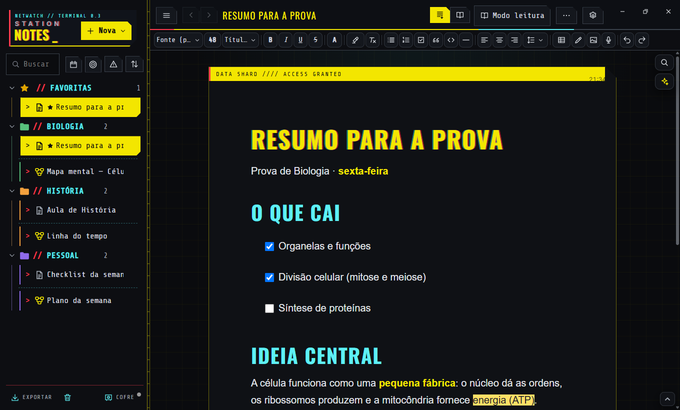 Soft cyberpunk (with a key)</td>
</tr>
<tr>
<td align="center">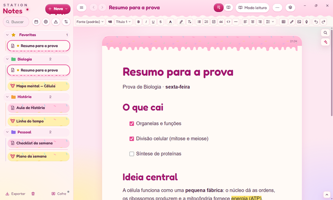 Melted ice cream (with a key)</td>
<td></td>
<td></td>
</tr>
</table>

## Android

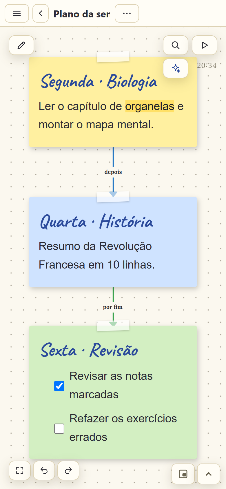&nbsp;&nbsp;
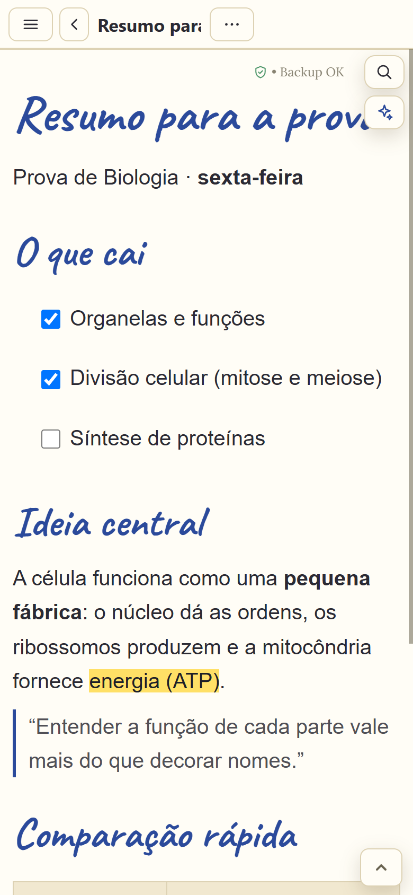&nbsp;&nbsp;
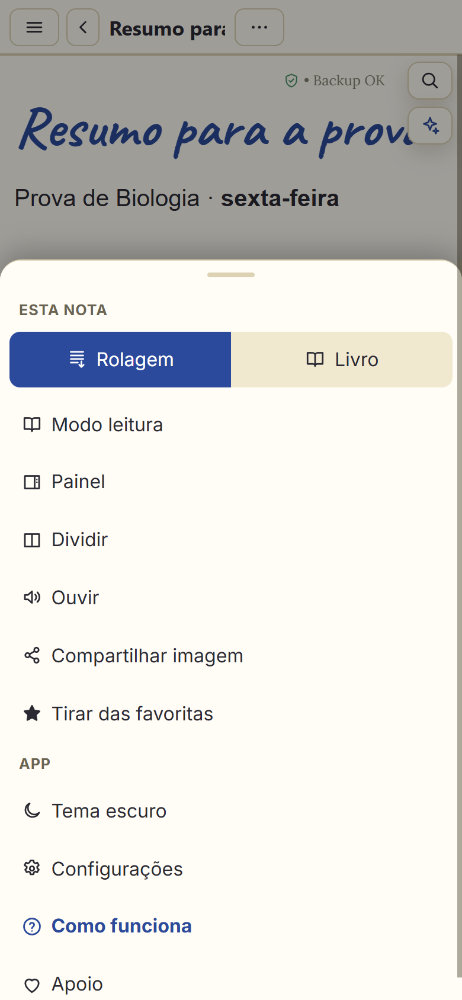

Same features as the desktop version, adapted for touch, with the formatting bar above the keyboard.

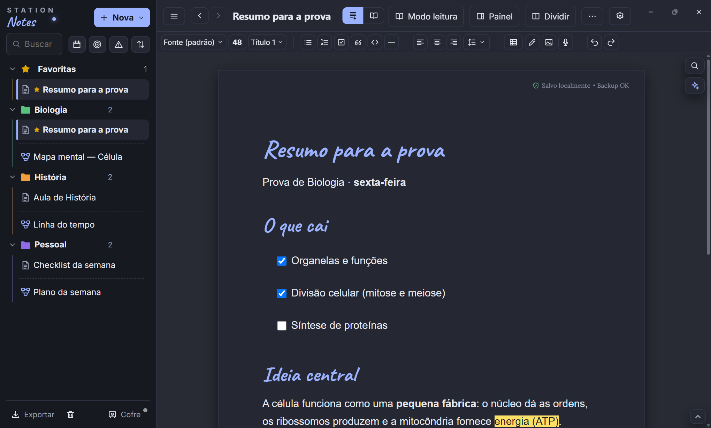

## Install

Grab the files from the [latest release](https://github.com/Fred-22-glitch/station-notes/releases/latest).

- **Windows:** `Station-Notes-Instalador-x.y.z.exe` (installer) or `Station-Notes-Portatil-x.y.z.zip` (portable: unzip and run `Station Notes.exe`). The installer isn't code-signed, so SmartScreen may warn you: *More info → Run anyway*.
- **Linux:** `Station-Notes-x.y.z-amd64.deb` (Ubuntu, Debian: `sudo apt install ./Station-Notes-x.y.z-amd64.deb`) or `Station-Notes-x.y.z-x86_64.AppImage` (`chmod +x`, then run).
- **Android:** `Station-Notes-x.y.z.apk`. You'll need to allow installing apps from unknown sources for your browser or file manager.

The installed Windows version and the Android app check GitHub Releases for updates and install them from inside the app (the Windows installer is verified against the published SHA-256). The portable and Linux versions open the release page instead.

## Getting started

1. On first launch, pick a folder for your notes (you can skip this and do it later).
2. Right-click the canvas background (long-press on Android) and choose a block type.
3. Drag the dot on a note's edge to another note to connect them.

The full guide is in the app under **⚙ → How it works**, and in [docs/GUIDE.md](docs/GUIDE.md).

## Pricing

Station Notes is paid, with a **5-day free trial**. During the trial everything is unlocked, except the Soft cyberpunk and Melted ice cream themes, which you can preview for a minute. The app warns you when the trial is about to end.

After the trial, a one-time key (no subscription) unlocks editing on up to 4 of your devices. Without a key your notes are never locked away: they stay on the device, readable, searchable and exportable.

The key also includes the study AI that runs on the device, downloaded once from Hugging Face (Windows and Linux: Qwen3 4B via llama.cpp; Android with 6 GB of RAM or more: Gemma 4 E2B on the GPU via LiteRT-LM, or Qwen3 4B on the CPU): summary, main topics, quote wall, flashcards, quick quiz, study plan until an exam date and automatic mind map. Long notes can go through ChatGPT, Gemini or Claude with a ready-made prompt instead.

You get the activation key by email and paste it under ⚙ → Station Notes Pro. It's checked offline; no account needed.

## Support

If you'd like to support development beyond the key:

- **Ko-fi** (card or PayPal): https://ko-fi.com/glitch22f
- **Pix** (Brazil only): [payment link](https://nubank.com.br/cobrar/xx14o/6ade9685-dae0-492a-bbc8-c0c2d7317304), or in the app under ⚙ → Support Station Notes

## Privacy

No account, no ads, no analytics. Notes stay on your device and in the folder you choose. The only network request is the update check against the GitHub API. Details in [docs/PRIVACY.md](docs/PRIVACY.md).

## Bugs and feature requests

Use [Issues](https://github.com/Fred-22-glitch/station-notes/issues/new/choose). Reports in English or Portuguese are fine.

## License

Station Notes is proprietary software: this repository contains releases and documentation, not source code. See [LICENSE](LICENSE).

Built with React, React Flow, TipTap, Tauri, Capacitor, Hunspell and Fontsource, among others. The full list of third-party licenses is in the app under ⚙ → Open source licenses.

© 2026 OmniStation
